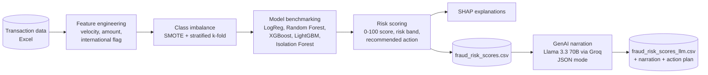

# Credit Card Fraud Detection: ML Risk Scoring + GenAI Analyst Narratives

An end-to-end fraud detection pipeline in two stages:

1. **Machine learning** scores every transaction for fraud risk, handling severe class imbalance and explaining each prediction with SHAP.
2. **Generative AI** (Llama 3.3 70B on Groq) turns each scored transaction into a plain-English explanation and a step-by-step action plan for the fraud operations team.

The result is a risk report that is accurate, explainable and readable by non-technical analysts.

---

## Pipeline



---

## Stage 1: Machine learning risk scoring

- **Feature engineering:** behavioural risk signals including 24-hour transaction velocity, transaction amount and an international-transaction flag, with categorical encoding and scaling
- **Class imbalance:** fraud is rare, so the pipeline uses SMOTE oversampling and stratified k-fold cross-validation
- **Model benchmarking:** supervised classifiers (Logistic Regression, Random Forest, XGBoost, LightGBM) compared against unsupervised anomaly detection (Isolation Forest)
- **Evaluation:** ROC-AUC, PR-AUC, F1 and confusion matrices. PR-AUC matters most here, because with very few fraud cases a model can score high accuracy while missing most fraud.
- **Risk scoring:** fraud probability is converted to a 0-100 risk score with a risk band (for example Low or High) and a recommended action (for example Approve)
- **Explainability:** SHAP shows which features drove each prediction, supporting model transparency and audit requirements

## Stage 2: GenAI analyst narratives (`fraud_llm.py`)

Reads `fraud_risk_scores.csv` and calls **Llama 3.3 70B (`llama-3.3-70b-versatile`) on Groq** for each transaction to add two columns:

| Column | Content |
|---|---|
| `narration` | 2-3 sentence plain-English explanation that references the actual values |
| `action_plan` | 3-5 numbered next steps for the operations team |

**Reliability and hallucination control:**
- **JSON mode** (`response_format={"type": "json_object"}`) for structured, parseable output
- **Low temperature (0.2)** for consistent answers across runs
- **Grounded system prompt:** the model acts as a senior fraud analyst and is told not to invent data that wasn't provided
- **Input schema validation:** the script stops with a clear message if required columns are missing
- **Retry with back-off** on API errors, and a safe fallback value if a call still fails

---

## Sample output

From `fraud_risk_scores_llm.csv`:

| transaction_id | amount | international | velocity_24h | risk_score | risk_band | action |
|---|---|---|---|---|---|---|
| TXN000001 | 321.52 | No | 1 | 9.6 | Low | Approve |

**Narration (generated):** the model explains that the transaction has a low risk score and fraud probability, and that the amount is typical for a domestic purchase, so the operations team can approve it with confidence.

---

## Tech stack

| Area | Tools |
|---|---|
| Data | Python, Pandas, NumPy, OpenPyXL |
| Machine learning | Scikit-learn, XGBoost, LightGBM, Isolation Forest |
| Imbalanced learning | imbalanced-learn (SMOTE), category-encoders |
| Explainability | SHAP |
| Visualisation | Matplotlib, Seaborn |
| Generative AI | Groq API, Llama 3.3 70B |

---

## Project structure

```
fraud-detection-analysis/
├── Fraud_Detection.py                # Stage 1: environment and library setup
├── fraud_llm.py                      # Stage 2: GenAI narration and action plans
├── fraud_detection_data_model-1.xlsx # Input transaction data
├── fraud_risk_scores.csv             # Stage 1 output
├── fraud_risk_scores_llm.csv         # Stage 2 output
└── Requirements.txt
```

---

## Quick start

```bash
git clone https://github.com/Neha2515416512/fraud-detection-analysis.git
cd fraud-detection-analysis
python -m venv venv
source venv/bin/activate          # Windows: .\venv\Scripts\Activate.ps1
pip install -r Requirements.txt

# Stage 1 output (fraud_risk_scores.csv) is already included.
# Stage 2: add GenAI narratives (needs a free Groq API key)
echo "GROQ_API_KEY=your_key_here" > .env
python fraud_llm.py
```

Get a free Groq API key at [console.groq.com](https://console.groq.com/).

---

## Roadmap

- Serve the model behind a FastAPI endpoint for real-time scoring
- Add a dashboard for risk bands and SHAP explanations
- Batch and cache LLM calls to reduce cost at higher volumes

---

## Author

**Neha Gowda**, AI Engineer, Dublin
[LinkedIn](https://www.linkedin.com/in/nehagowda2001) · [GitHub](https://github.com/Neha2515416512)
